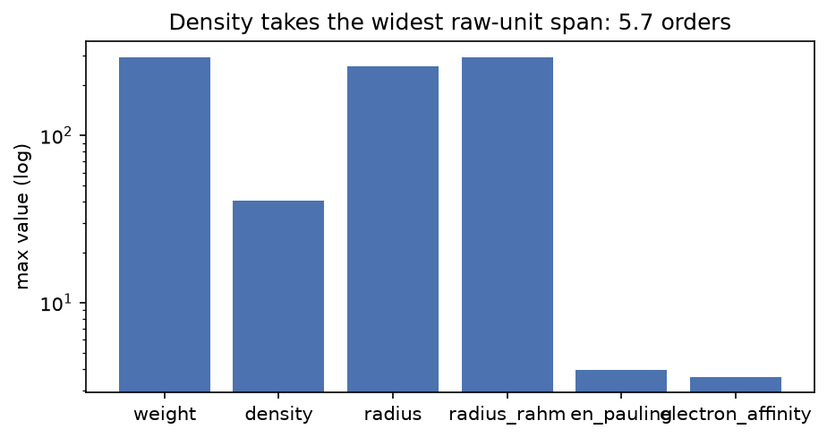
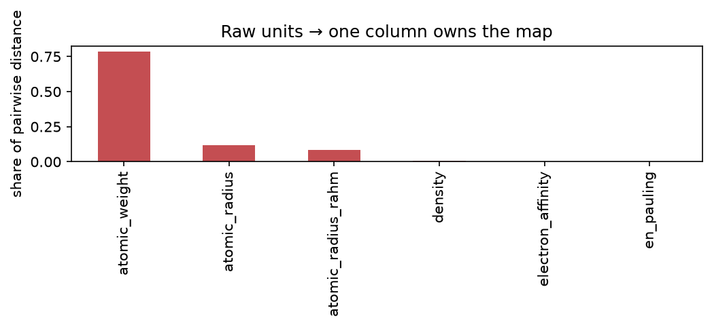
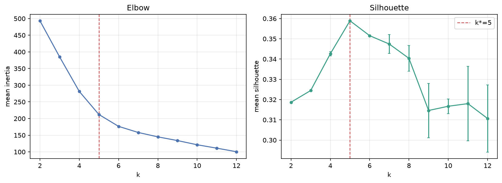
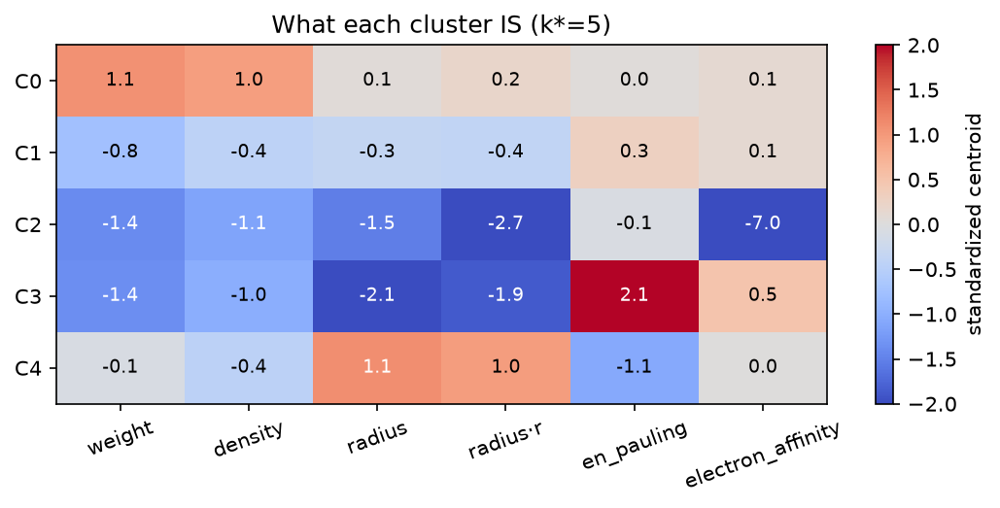
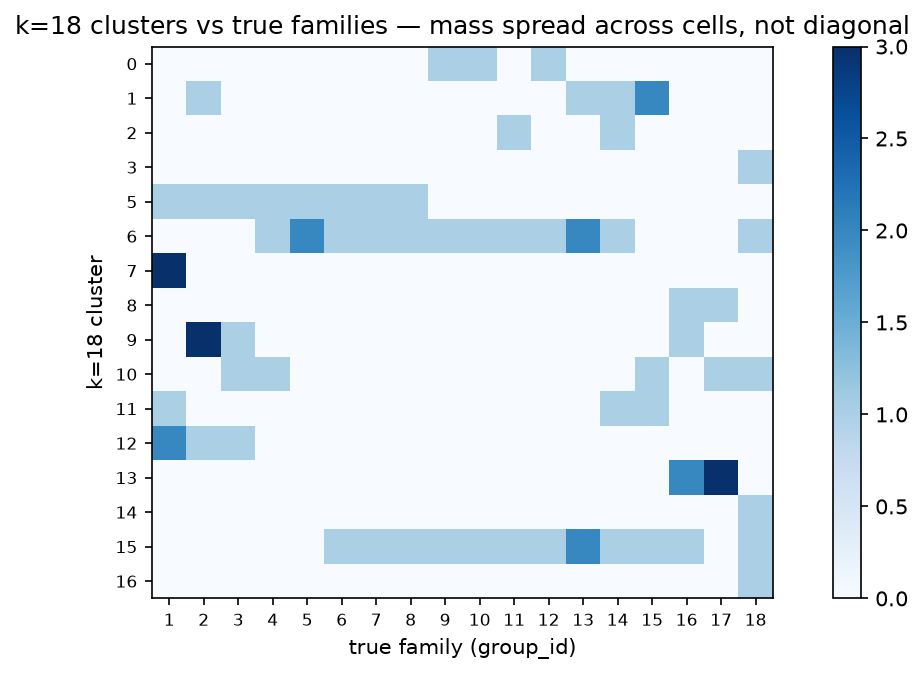
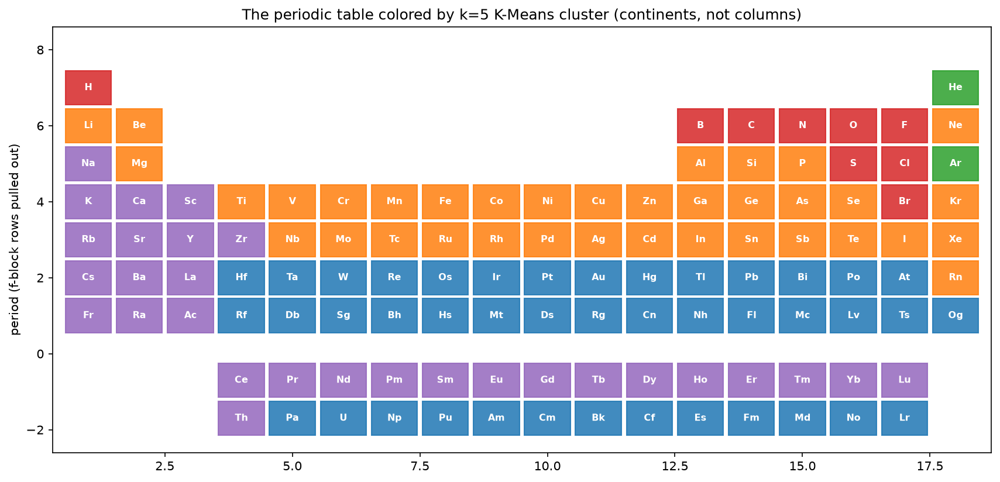
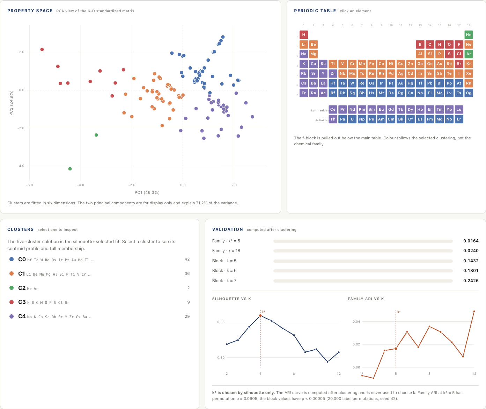
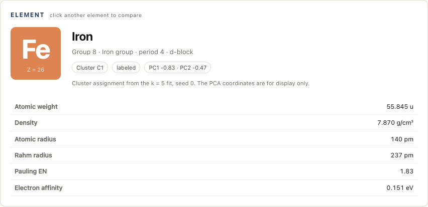
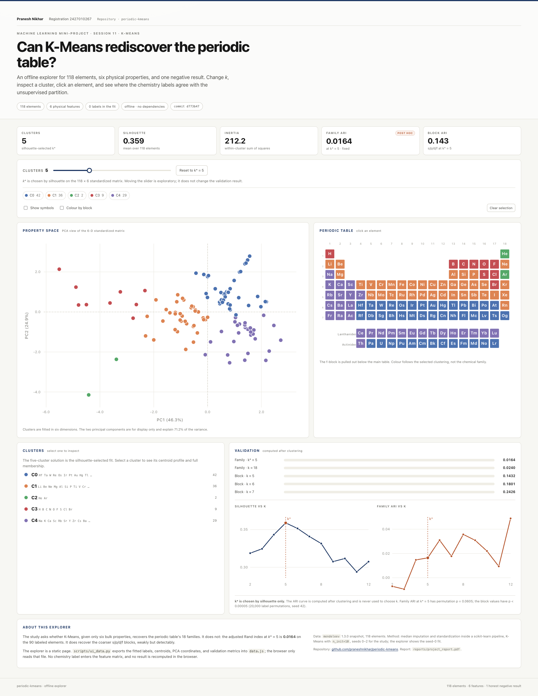
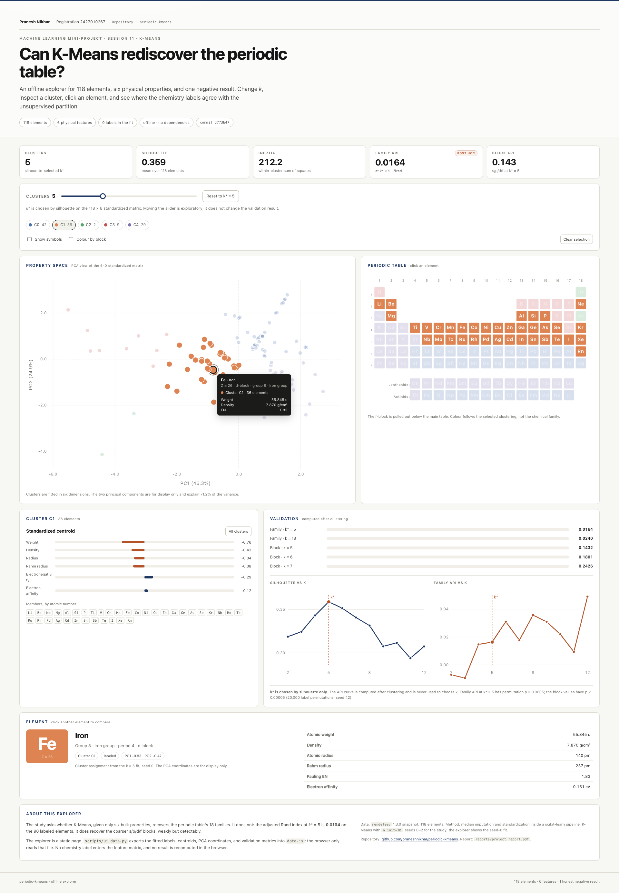

# Abstract

The periodic table arranges the elements into 18 families whose members share outer-shell electron configurations, yet those families differ enormously in bulk properties. This report asks a deliberately narrow question: can K-Means, given only six physical properties for all 118 elements, recover the families without supervision? The pipeline imputes missing values with a median inside a scikit-learn pipeline, standardizes the six features, fits K-Means for *k* = 2 to 12 across three seeds, and selects *k* by silhouette. At the selected *k* = 5 (mean silhouette 0.359), the adjusted Rand index (ARI) against the 18 families is 0.0164 ± 0.0000 on the 90 labeled elements. A permutation check places that value at the 95th percentile of the no-structure null (*p* = 0.0605), so the family hypothesis is not supported. Forcing *k* = 18 gives ARI 0.0240 (*p* = 0.0824). Against the coarser s/p/d/f blocks, however, the same partitions score 0.143, 0.180, and 0.243 for *k* = 5, 6, and 7 (*p* < 0.00005), which is weak but detectable structure. The clusters trace broad regions of the table, not its columns: a dense heavy cluster, a light-to-mid metal cluster, a small electronegative nonmetal cluster, a large electropositive alkali/alkaline-earth/lanthanide cluster, and a two-element He/Ar cluster produced by extreme electron affinities. The negative result is therefore structured rather than accidental. Bulk properties encode period and block more strongly than group, and no choice of *k* can turn a property gradient into a valence-based column. A companion offline explorer exposes the fitted partitions, element profiles, and validation battery for inspection without refitting or label leakage. The report documents the leakage guards, seed policy, raw-unit trap, and reproducibility checks that make the result trustworthy.

**Keywords:** K-Means; cluster validation; adjusted Rand index; silhouette; periodic table; negative result; reproducibility.

---

# Key results at a glance

| Question | Instrument | Result | Reading |
|---|---|---|---|
| How many clusters? | Silhouette, *k* = 2 to 12, 3 seeds | *k*\* = 5, mean silhouette 0.359 | A plateau, not a sharp optimum |
| Do clusters recover the 18 families? | ARI on 90 labeled elements | **0.0164 ± 0.0000** | Fails; *p* = 0.0605 against a permutation null |
| Does forcing 18 clusters help? | ARI at *k* = 18 (validation only) | **0.0240** | No; *p* = 0.0824 |
| Is there any real structure? | ARI against s/p/d/f blocks | **0.143 / 0.180 / 0.243** at *k* = 5/6/7 | Weak but detectable; *p* < 0.00005 |
| Is the verdict fragile to hydrogen? | ARI with and without H | **Δ = +0.0016** | No |
| Where do the 28 unlabeled elements land? | Descriptive audit | 15 in C4, 13 in C0 | Chemically sensible, not validated |
| Would raw units have worked? | Share of raw pairwise distance | **78.71% owned by atomic weight** | No; raw clustering is weight clustering |
| Can a reader inspect the result? | Offline explorer (`app/index.html`) | *k* slider, element cards, periodic table | Read-only; no refit and no label leakage |

---

# 1. Introduction

## 1.1 A taxonomy worth testing

The periodic table is one of the most successful classification systems in science. Its columns, the groups, collect elements that behave similarly: the alkali metals react vigorously with water, the halogens form salts, and the noble gases are chemically inert under ordinary conditions. The table is not merely a convenient display. It is a compact statement about valence electrons, and its predictive power comes from that underlying electronic structure.

That makes the table an attractive target for an unsupervised experiment. If a clustering algorithm is given a set of measurable properties and no chemistry labels, will it place the elements into the same families that generations of chemists have identified? A positive answer would suggest that the families are strongly imprinted on bulk properties. A negative answer would be equally informative: it would show that the chemical taxonomy depends on a variable that the feature set does not contain.

This report describes such an experiment for the 118 known elements. The algorithm is K-Means, the feature set is six physical properties, and the validation instrument is the adjusted Rand index against the 18 families. The work was completed as a machine-learning mini-project anchored to a session on K-Means, elbow selection, and silhouette analysis.

## 1.2 Research question and hypothesis

The research question is:

> Given only six bulk physical properties of the 118 elements, can K-Means recover the 18 periodic families without using any chemistry label during fitting or model selection?

The hypothesis tested here is that valence configuration leaves a strong enough imprint on bulk physical properties that a density-based partition of standardized features will recover the families. This is a plausible hypothesis. Elements in the same group share outer-shell electron counts, and those counts influence atomic size, ionization behavior, and electron affinity. If those influences are strong enough, the groups should appear as dense regions in property space.

The alternative is that bulk properties primarily encode position in the table: period, block, and the gradual changes in size and density that accompany increasing atomic number. On that view, K-Means will recover broad regions of the table but not its columns. The experiment is designed to distinguish these two outcomes rather than to force the first one.

## 1.3 What this report contributes

The contribution is not a new clustering algorithm. It is a complete, auditable case study with five parts:

1. A leakage-free pipeline that keeps the chemistry truth out of the feature matrix and computes every validation metric after clustering.
2. A reproducible study of *k* selection using both the elbow and the silhouette across three seeds.
3. A multi-granularity validation battery: family-level ARI, a validation-only *k* = 18 companion, block-level ARI, a hydrogen sensitivity check, and an audit of the 28 elements that have no family label.
4. A mechanistic explanation of why the family-level hypothesis fails, supported by the geometry of the feature space and by the composition of the clusters.
5. A supplementary permutation calibration that separates "statistically detectable" from "practically meaningful" and prevents the negative result from being overstated.

## 1.4 Scope and non-goals

The study is deliberately restricted. It uses K-Means only, not hierarchical clustering, Gaussian mixtures, or density-based methods. It uses six bulk properties only, not valence-electron counts, oxidation states, or block indicators. It does not attempt to predict properties of new elements, and it does not claim that the periodic table has been "discovered" by an algorithm. The language throughout is "recover" or "reproduce", never "discover".

The restriction is the point. Adding valence information would make the task easier, but it would also answer a different question. The question here is whether the families are visible in the physical properties alone.

---

# 2. Background

## 2.1 K-Means in one page

K-Means partitions *n* observations into *k* groups by minimizing the within-cluster sum of squared Euclidean distances to the cluster centroids. If *C* is a partition and μ*c* is the mean of cluster *c*, the objective is

> *W*(*C*) = Σ over clusters *c* Σ over points *x* in *c* ||*x* − μ*c*||².

The classical algorithm, usually attributed to Lloyd (1982) and closely related to the earlier work of MacQueen (1967), alternates two steps until convergence: assign each point to its nearest centroid, then recompute each centroid as the mean of its assigned points. Each step cannot increase the objective, so the procedure converges to a local optimum. The result depends on initialization, which is why modern implementations combine multiple starts with k-means++ seeding (Arthur & Vassilvitskii, 2007).

K-Means has known limitations that matter for this study. It assumes that clusters are roughly convex and isotropic in the chosen metric, it requires *k* to be specified in advance, and it is sensitive to feature scaling because Euclidean distance mixes units. It also tends to produce clusters of similar spatial extent, and it has no built-in notion of a "correct" cluster. These are not defects to be hidden; they are part of the experimental setup and are addressed explicitly in the method (Steinley, 2006).

In this project, *n* = 118, *d* = 6, *k* ranges from 2 to 12, each fit uses `n_init = 10`, and the seeds are 0, 1, and 2.

## 2.2 Choosing the number of clusters

Two instruments are used. The first is the elbow plot: inertia, the value of the objective at convergence, is plotted against *k*, and the analyst looks for a bend where additional clusters stop producing large reductions. The elbow is popular because it is cheap and intuitive, but it is also subjective. A gradual curve has no unambiguous knee, and different readers can choose different *k* values from the same plot (Milligan & Cooper, 1985).

The second instrument is the silhouette (Rousseeuw, 1987). For a point *i*, let *a*(*i*) be the mean distance to the other points in its own cluster and *b*(*i*) the smallest mean distance to the points in any other cluster. The silhouette of the point is

> *s*(*i*) = (*b*(*i*) − *a*(*i*)) / max{*a*(*i*), *b*(*i*)}.

The value lies between −1 and 1. A value near 1 means the point is much closer to its own cluster than to the nearest alternative; a value near 0 means the point sits on a boundary; a negative value means it is probably in the wrong cluster. The mean silhouette over all points summarizes how well separated the partition is. Kaufman and Rousseeuw (1990) offer the familiar rule of thumb that values below about 0.25 indicate weak structure, values around 0.5 indicate reasonable structure, and values above 0.7 indicate strong structure. Those thresholds are conventions, not statistical tests.

The study uses the silhouette as the decision rule, taking the *k* with the highest mean silhouette, and uses the elbow as a visual check. Both are computed on the same standardized geometry and averaged over three seeds.

## 2.3 Adjusted Rand Index

The adjusted Rand index (ARI) compares two partitions of the same objects (Hubert & Arabie, 1985). It counts pairs of objects that are grouped together in both partitions or separated in both partitions, then corrects the agreement for what would be expected by chance. The index is 1 when the partitions are identical, approximately 0 when they agree no better than independent random partitions, and can be negative when they agree less than chance. It is symmetric and does not require the two partitions to have the same number of clusters, which is why it is suitable for comparing a K-Means partition with a family labeling that has 18 categories.

ARI is a descriptive index, not a hypothesis test. A value of 0.02 is small, but whether it is distinguishable from noise depends on the number of objects, the cluster sizes, and the distribution of the labels. For that reason, the report adds a permutation calibration in Section 4.5. The calibration does not change the observed ARI; it changes the strength of the claim that can be made about it.

## 2.4 What the periodic table encodes

The modern periodic table has 118 confirmed elements, arranged by atomic number into seven periods and 18 groups. The s, p, d, and f blocks correspond to the subshell being filled. Group membership is defined by the valence-electron configuration: the alkali metals have one outer *s* electron, the halogens are one electron short of a closed shell, and the noble gases have a closed shell (Housecroft & Sharpe, 2018).

Bulk properties do not follow the columns neatly. Atomic weight increases down a group and across a period. Density generally increases across a period and then behaves irregularly in the transition series. Atomic radius increases down a group and decreases across a period. Electronegativity generally increases across a period and decreases down a group, but the trend is noisy and several elements have no meaningful Pauling value. Electron affinity is even less regular: it is negative for some elements, positive for others, and missing for the noble gases that do not form stable anions.

The f-block is usually drawn separately: the lanthanides (Ce to Lu) and the actinides (Th to Lr) are chemically similar within each series and are not assigned to the 18 columns in the same way as the main-group and transition elements. In the source data used here, 28 elements have no `group_id`: Ce through Lu and Th through Lr. That missingness is a property of the labeling convention, not a data error.

Two conventions deserve mention because they affect validation. Hydrogen is placed in group 1 by cartography, but it is not an alkali metal; it is a nonmetal with its own chemistry. Helium is placed in group 18, but its closed 1s shell makes it unlike the heavier noble gases in some respects. The hydrogen sensitivity check in Section 5.6 exists because the first convention could influence the family-level score.

The hypothesis can now be stated precisely. If valence configuration dominates the six bulk properties, elements in the same group should be close in the six-dimensional standardized space, and K-Means should recover the groups. If period and block dominate, the clusters should follow broad regions of the table instead. The chemistry literature suggests the second outcome is more likely, because the properties in the feature set are precisely the ones that vary strongly with period.

---

# 3. Data

## 3.1 Source and offline snapshot

The data come from version 1.3.0 of the `mendeleev` Python package (Mentel, 2024), using `fetch_table("elements")`. The raw table has 118 rows and 83 columns. A snapshot is committed at `data/elements.csv`, and `src/data.py` loads that snapshot when it exists. If the snapshot is absent, the loader fetches the table from `mendeleev`, writes a new snapshot, and returns it. This design means a grader can run every notebook without network access, while a fresh machine can still rebuild the data.

The snapshot is part of the reproducibility contract. The results in this report were recomputed from the committed snapshot at commit `d773b47`. The loader is covered by tests for row count, required feature columns, the noble-gas missingness pattern, and a positive atomic weight for every row.

## 3.2 Feature set and coverage

Six physical properties are used as features. They are listed in Table 1 along with their coverage. The last three rows of the table are chemistry-truth columns; they are shown for completeness and are never used as features.

**Table 1. Feature coverage in the 118-element snapshot.**

| Column | Role | Non-null | Coverage |
|---|---|---:|---:|
| `atomic_weight` | Feature | 118 | 100.0% |
| `density` | Feature | 118 | 100.0% |
| `atomic_radius` | Feature | 90 | 76.3% |
| `atomic_radius_rahm` | Feature | 96 | 81.4% |
| `en_pauling` | Feature | 85 | 72.0% |
| `electron_affinity` | Feature | 77 | 65.3% |
| `group_id` | Truth, validation only | 90 | 76.3% |
| `period` | Truth, validation only | 118 | 100.0% |
| `block` | Truth, validation only | 118 | 100.0% |

The two radius columns are different definitions of atomic radius. The classic `atomic_radius` is available for 90 elements; the Rahm radius is available for 96. Both are retained. The design allowed either to be the primary radius, and keeping both avoids an arbitrary choice while leaving a formal radius-definition ablation to future work.

The feature matrix is therefore 118 rows by 6 columns. No row is dropped. The 28 elements without a family label are still clustered; they are excluded only from the ARI calculation, because there is no ground truth to compare them against. This is the right choice for an unsupervised question: the clustering is allowed to use every element, and the validation is restricted to the subset where a label exists.

## 3.3 Unit heterogeneity

The six features are measured in incompatible units: atomic weight in unified atomic mass units, density in grams per cubic centimetre, radii in picometres, Pauling electronegativity on a dimensionless scale, and electron affinity in electron volts. Their numerical ranges differ by many orders of magnitude. Table 2 summarizes the raw distributions.

**Table 2. Raw-unit heterogeneity. The final column is the base-10 span for positive-valued features; electron affinity is signed and is therefore described separately.**

| Feature | Minimum | Median | Maximum | Span (orders of magnitude) |
|---|---:|---:|---:|---:|
| `atomic_weight` | 1.008 | 142.575 | 294.000 | 2.5 |
| `density` | 0.000082 | 7.885 | 40.700 | 5.7 |
| `atomic_radius` | 25.000 | 145.000 | 260.000 | 1.0 |
| `atomic_radius_rahm` | 134.000 | 244.000 | 293.000 | 0.3 |
| `en_pauling` | 0.700 | 1.700 | 3.980 | 0.8 |
| `electron_affinity` | −19.700 | 0.650 | 3.613 | Signed range, not a positive span |

Density alone covers 5.7 orders of magnitude, from the gas-phase density of hydrogen to the density of hassium. Atomic weight covers 2.5 orders. The radii, by contrast, vary by factors of about 2 to 10. A Euclidean distance computed on raw values would therefore be dominated by the columns with the largest numerical scale, regardless of their scientific importance. Figure 1 shows the same point visually.

{width=82%}

**Figure 1.** Maximum raw value per feature on a logarithmic scale. Density has the widest span, but atomic weight has the largest absolute values and therefore the largest influence on an unscaled Euclidean distance.

The figure explains why standardization is not a cosmetic step. It is a precondition for the comparison to mean anything. Section 4.2 quantifies the distortion directly.

## 3.4 Missing values that mean something

Missing values in this dataset are not random data-entry gaps. They often record a chemical fact. The noble gases are the clearest case. Helium, neon, argon, krypton, and radon have no Pauling electronegativity because they do not form ordinary bonds. Xenon is the exception: it has a value of 2.6 because xenon forms compounds such as XeF2 and XeF4. The pattern is chemistry, not corruption.

Electron affinity is equally informative. Helium and argon have large negative values (−19.7 eV and −11.5 eV) because adding an electron to a closed shell costs energy. Neon, krypton, and radon have missing values. Oganesson has a small positive value in this snapshot. These values are not errors to be smoothed away; they are part of the signal.

**Table 3. The noble gases in the snapshot. Missing electronegativity is a chemical fact, not a data defect.**

| Element | Group | Pauling electronegativity | Electron affinity (eV) |
|---|---:|---:|---:|
| He | 18 | Missing | −19.700 |
| Ne | 18 | Missing | Missing |
| Ar | 18 | Missing | −11.500 |
| Kr | 18 | Missing | Missing |
| Xe | 18 | 2.600 | −0.056 |
| Rn | 18 | Missing | Missing |
| Og | 18 | Missing | 0.056 |

The imputation policy follows from this. Missing values are filled with the median of the column, and the imputer is fitted inside the scikit-learn pipeline. No row is dropped. The median is a pragmatic choice: it preserves the row count and avoids inventing extreme values. It is not a chemistry-aware imputation, and Section 6.4 shows one consequence. The noble gases with missing electron affinity receive a value near the median, while helium and argon keep their observed extreme values. That difference changes where they land.

## 3.5 Keeping the answer out of the features

The central integrity rule is that the chemistry truth must never enter the feature matrix. `group_id`, `period`, and `block` describe the answer. If any of them were used as a feature, the clustering would be circular: the algorithm would be told part of the label it is supposed to recover.

The rule is enforced in three places. First, the feature list in `src/study.py` contains only the six physical properties. Second, notebook 01 contains an assertion that the feature set and the truth set are disjoint. Third, `tests/test_study.py` contains a leakage guard that fails if `group_id`, `period`, or `block` ever appears among the feature names. The ARI is computed after the clustering is complete, and the *k* = 18 companion is explicitly validation-only. It is never used to choose *k*.

There is a subtler point. The clustering uses all 118 elements, including the 28 without a family label, while the ARI uses only the 90 labeled elements. This is not label leakage, because no label enters the fit. It is a transductive design: the unlabeled elements influence the centroids and therefore the assignments of the labeled elements. That is appropriate for the question "what structure is in the full table?", but it should be stated rather than hidden.

---

# 4. Method

## 4.1 Preprocessing and clustering pipeline

The pipeline has three steps:

1. **Median imputation.** `SimpleImputer(strategy="median")` fills missing feature values with the column median. The imputer is fitted on the feature matrix inside the pipeline.
2. **Standardization.** `StandardScaler()` subtracts the column mean and divides by the column standard deviation. After this step, every feature has mean 0 and unit variance, so no column can dominate the Euclidean distance by virtue of its units.
3. **K-Means.** `KMeans(n_clusters=k, n_init=10, random_state=seed)` fits the standardized matrix, using the scikit-learn implementation (Pedregosa et al., 2011). The default initialization is k-means++, and `n_init=10` repeats the fit with ten different centroid seeds, keeping the best inertia.

The study sweeps *k* from 2 to 12 and repeats every fit for seeds 0, 1, and 2. For each *k*, it records the mean and standard deviation of inertia and silhouette across seeds. The final descriptive fit uses *k*\* = 5 and seed 0, and the centroids are reported in standardized units: a value of +1 means one standard deviation above the periodic-table average for that feature.

Because the study is unsupervised, there is no train/test split. The imputer and scaler are fitted on the full 118 × 6 matrix. This is standard for a descriptive clustering study, but it is not the same as a supervised pipeline with held-out data. The report describes the design as transductive rather than claiming more than it can support.

## 4.2 The raw-unit baseline

Before standardizing, the study measures how much of the raw pairwise-distance geometry each feature would own. For feature *f*, the share is

> share(*f*) = Σ over pairs (*i*, *j*) of [*x*(*i*, *f*) − *x*(*j*, *f*)]² divided by the sum of that quantity over all six features.

The calculation uses median-imputed raw values, not standardized values, so it reflects what a naive K-Means would actually see. The results are shown in Figure 2.

{width=82%}

**Figure 2.** Share of the raw-unit pairwise squared distance owned by each feature. Atomic weight alone accounts for 78.71% of the geometry; density accounts for 0.72%.

The numbers are stark. Atomic weight owns 78.71% of the raw geometry. The classic radius owns 12.01%, the Rahm radius 8.51%, density 0.72%, electron affinity 0.05%, and Pauling electronegativity approximately 0.00%. A K-Means fit on raw values would therefore be a weight-only clustering with a small radius correction. That is not a chemistry finding; it is a unit artifact. Standardization removes it by giving each feature equal variance.

This exhibit is worth keeping in a report because it shows what the alternative would have been. The choice to standardize is not presented as a preference; it is justified by a measurement.

## 4.3 Selecting k without looking at labels

The selection rule is fixed before the labels are touched. For each *k*, the pipeline computes the mean silhouette over the three seeds and chooses the *k* with the largest mean. The elbow curve is inspected as a secondary check, but it does not override the silhouette. No family label, block label, or period label is used at this stage.

The rule is simple, but it has a known weakness: the silhouette rewards separation, and a partition can be well separated without being chemically meaningful. Section 6.3 discusses that weakness in light of the observed value.

## 4.4 Validation protocol

The validation battery has five parts, each chosen to answer a different objection.

1. **Family-level ARI at *k*\*.** The primary test. Cluster labels are compared with `group_id` on the 90 labeled elements, for each of the three seeds. The result is reported as mean ± standard deviation.
2. **Validation-only *k* = 18 companion.** A skeptic could argue that *k* = 5 is too coarse to recover 18 families. The companion run forces 18 clusters, the number of families, and computes ARI again. It is never used to select *k*; it is a stress test of the "wrong *k*" objection.
3. **Block-level ARI.** The same partitions are compared with the s/p/d/f block labels at *k* = 5, 6, and 7. If the pipeline is functioning, it should find at least the coarser structure. This serves as a positive control.
4. **Hydrogen sensitivity.** Hydrogen is labeled group 1 by convention but is not an alkali metal. The ARI is recomputed with hydrogen excluded from the labeled set. A large change would mean the verdict depends on one questionable label.
5. **Unlabeled-element audit.** The 28 elements without a family label are assigned to clusters like every other element. Their destinations are reported descriptively. They cannot be scored, because there is no ground truth.

## 4.5 Supplementary permutation calibration

ARI has an expected value of approximately zero under a random partition, but "approximately zero" is not a confidence interval. To calibrate the observed values, the report uses a permutation test. The cluster labels are randomly permuted 20,000 times while the true labels are held fixed, and ARI is recomputed on each permutation. The one-sided *p*-value is the fraction of permuted scores at least as large as the observed score, with the usual add-one correction:

> *p* = (1 + number of permuted scores ≥ observed) / (1 + 20,000).

The permutation preserves the cluster-size distribution and destroys any association with the truth. It therefore answers the question: if the clustering had no relationship to the family labels, how often would an ARI this large appear? The procedure uses a fixed random generator seed (42) so the numbers are reproducible. It is a supplementary check added for this report; the original notebook battery reports the ARI values without a null calibration.

## 4.6 Reproducibility engineering

The project is organized so that the notebooks stay thin and the logic lives in two tested modules. `src/data.py` handles loading and the offline snapshot. `src/study.py` contains the feature matrix builder, the raw-share demonstration, the elbow and silhouette sweep, and the final label fit. The notebooks import these functions rather than reimplementing the analysis.

The test suite collects 16 tests: four for the data layer, five for the study layer, three documentation-consistency tests added in the final review, and four contract tests for the interface payload. The data tests check the row count, the required feature columns, the noble-gas missingness pattern, and the snapshot. The study tests check the leakage guard, the matrix shape, the raw-share domination, the elbow and silhouette table, and the final fit. The consistency tests check that the hydrogen sensitivity sign and the *k* = 18 value in the prose match the executed notebook outputs, and that the figure artifacts exist. The payload tests check the 118 × 11 label tables, the absence of truth columns from the feature list, the headline metrics, and the periodic-table layout.

All three notebooks are committed with their outputs, so a reader can inspect the results without rerunning anything. The data snapshot makes the run offline. The seeds are fixed. The environment used for the reported results was Python 3.14.2 with scikit-learn 1.9.1, pandas 3.1.0, matplotlib 3.11.2, and mendeleev 1.3.0.

---

# 5. Results

## 5.1 Choosing k: a plateau, not a knee

Table 4 reports the sweep. Inertia falls from 493.37 at *k* = 2 to 100.46 at *k* = 12. The largest absolute drops are early: 108.23 from *k* = 2 to 3, 103.58 from 3 to 4, and 69.39 from 4 to 5. After *k* = 5, the drops shrink steadily. There is no sharp bend that isolates a single correct *k*. The curve is a smooth decay, which is what a gradient-like cloud produces.

**Table 4. Elbow and silhouette across three seeds. Inertia is the K-Means objective; silhouette is the mean over all 118 elements.**

| *k* | Inertia (mean) | Inertia (SD) | Silhouette (mean) | Silhouette (SD) |
|---:|---:|---:|---:|---:|
| 2 | 493.368 | 0.000 | 0.319 | 0.000 |
| 3 | 385.142 | 0.000 | 0.324 | 0.000 |
| 4 | 281.566 | 0.061 | 0.343 | 0.001 |
| **5** | **212.178** | **0.000** | **0.359** | **0.000** |
| 6 | 176.576 | 0.000 | 0.352 | 0.000 |
| 7 | 158.246 | 0.599 | 0.347 | 0.005 |
| 8 | 145.036 | 0.414 | 0.340 | 0.006 |
| 9 | 133.915 | 0.722 | 0.315 | 0.013 |
| 10 | 121.335 | 0.571 | 0.317 | 0.004 |
| 11 | 111.113 | 1.696 | 0.318 | 0.018 |
| 12 | 100.460 | 1.036 | 0.311 | 0.017 |

The silhouette peaks at *k* = 5 with a mean of 0.359. The values at *k* = 6 and *k* = 7 are 0.352 and 0.347, only 0.007 and 0.012 lower. This is a plateau, not a decisive maximum. The peak is also modest in absolute terms: 0.359 is below the conventional "reasonable structure" region and well below the 0.5 mark. The curve says that the best partition is only weakly separated.

{width=96%}

**Figure 3.** Elbow and silhouette curves for *k* = 2 to 12. The elbow has no sharp knee; the silhouette peaks at *k* = 5 and then declines slowly. Error bars are standard deviations over seeds 0, 1, and 2.

The seed behavior is informative. At *k* = 5 and *k* = 6, the inertia and silhouette standard deviations are exactly zero: all three seeds converge to the same solution. At *k* = 7 and above, the standard deviations grow, reaching 1.696 for inertia and 0.018 for silhouette at *k* = 11. The *k* = 5 solution is stable across seeds, but stability is not the same as validity. A stable local optimum can still be the wrong description of the data.

## 5.2 The five clusters

The fit at *k*\* = 5 and seed 0 has inertia 212.18. The cluster sizes are 42, 36, 2, 9, and 29. The centroids in standardized units are shown in Table 5, and the heatmap is Figure 4.

**Table 5. Standardized centroids at *k*\* = 5. Values are standard deviations from the periodic-table mean for each feature.**

| Cluster | Weight | Density | Radius | Rahm radius | Electronegativity | Electron affinity |
|---|---:|---:|---:|---:|---:|---:|
| C0 | +1.08 | +0.95 | +0.06 | +0.19 | +0.03 | +0.12 |
| C1 | −0.76 | −0.43 | −0.34 | −0.38 | +0.29 | +0.12 |
| C2 | −1.40 | −1.14 | −1.53 | −2.67 | −0.07 | −6.96 |
| C3 | −1.37 | −1.01 | −2.13 | −1.87 | +2.14 | +0.49 |
| C4 | −0.09 | −0.45 | +1.11 | +0.97 | −1.07 | +0.01 |

{width=78%}

**Figure 4.** Standardized centroids for the five clusters. Blue indicates below-average values, red above-average. The electron-affinity value for C2 is an extreme outlier at −6.96 standard deviations.

The clusters can be read as follows. Representative members are listed in Table 6, and the full membership is in the notebook output.

- **C0 (42 elements): the dense heavy body.** This cluster contains the heavy transition metals (Hf, Ta, W, Re, Os, Ir, Pt, Au, Hg), the post-transition metals (Tl, Pb, Bi, Po), and the actinides (Pa through Lr), plus the superheavy elements (Rf through Og). Its centroid is high on weight and density, average on radius and electronegativity. It is a "heavy and dense" region, not a family.
- **C1 (36 elements): the light-to-mid body.** This is the largest mixed cluster: Li, Be, Ne, Mg, Al, Si, P, the first-row transition metals Ti through Zn, Ga through Ge, As, Se, Kr, Nb through Cd, In through Te, I, Xe, and Rn. Its centroid is below average on weight, density, and radius, and slightly above average on electronegativity. It is a broad region of moderate-size metals, metalloids, and heavier nonmetals.
- **C2 (2 elements): helium and argon.** This is not a chemical family; it is an outlier cluster. Both elements have large negative electron affinities, and that single feature drives the centroid to −6.96 standard deviations. Neon, krypton, and radon have missing electron affinities, were median-imputed near zero, and therefore landed in C1 rather than C2. The cluster is a useful warning about what K-Means does with a heavy-tailed feature.
- **C3 (9 elements): the small electronegative nonmetals.** H, B, C, N, O, F, S, Cl, and Br. The centroid is very high on electronegativity (+2.14) and very low on radius (−2.13 and −1.87). This is the closest thing to a chemically interpretable group cluster, but it still mixes halogens with chalcogens, pnictogens, carbon-group elements, and hydrogen.
- **C4 (29 elements): the large electropositive metals.** Na, K, Ca, Sc, Rb, Sr, Y, Zr, Cs, Ba, La through Lu, Fr, Ra, Ac, and Th. The centroid is high on radius (+1.11 and +0.97) and low on electronegativity (−1.07). It collects the alkali metals, the alkaline-earth metals, the scandium group, and most of the lanthanides. This is a "large, electron-donating" region, again spanning many families.

**Table 6. Cluster composition at *k*\* = 5, with representative members and block counts.**

| Cluster | *n* | Representative members | s | p | d | f | Reading |
|---|---:|---|---:|---:|---:|---:|---|
| C0 | 42 | Hf, Ta, W, Re, Os, Ir, Pt, Au, Hg; Pa–Lr; Rf–Og | 0 | 11 | 18 | 13 | Dense heavy metals and actinides |
| C1 | 36 | Li, Be, Ne, Mg, Al, Si, P; Ti–Zn; Ga–Ge; As, Se, Kr; Nb–Cd; In–Te; I, Xe, Rn | 3 | 16 | 17 | 0 | Light-to-mid metals, metalloids, heavy nonmetals |
| C2 | 2 | He, Ar | 1 | 1 | 0 | 0 | Extreme electron-affinity outliers |
| C3 | 9 | H, B, C, N, O, F, S, Cl, Br | 1 | 8 | 0 | 0 | Small, highly electronegative nonmetals |
| C4 | 29 | Na, K, Ca, Sc, Rb, Sr, Y, Zr, Cs, Ba, La–Lu, Fr, Ra, Ac, Th | 9 | 0 | 5 | 15 | Large electropositive metals and lanthanides |

The block counts already reveal the pattern that the ARI will quantify. C4 is dominated by s and f elements; C0 is dominated by d and f elements; C3 is almost entirely p; C1 is a mix of s, p, and d. The clusters align with blocks much more than with groups. No cluster is a single family, and several clusters contain elements from opposite ends of the table.

## 5.3 Family-level validation: the hypothesis fails

The primary result is shown in Table 7. For all three seeds, the ARI against the 18 families is 0.0164. The standard deviation is 0.0000 because the three seeds produce the same partition at *k* = 5.

**Table 7. Family-level ARI at *k*\* = 5, computed on the 90 labeled elements.**

| Seed | ARI |
|---:|---:|
| 0 | 0.0164 |
| 1 | 0.0164 |
| 2 | 0.0164 |
| **Mean ± SD** | **0.0164 ± 0.0000** |

The permutation calibration puts this value in context. Under the null, the mean ARI is −0.00002 and the standard deviation is 0.00945. The observed 0.0164 is about 1.7 null standard deviations above zero, and it sits at the 95th percentile of the null distribution to four decimal places. The one-sided *p*-value is 0.0605. At the conventional 0.05 threshold, the result is not statistically significant; more importantly, the effect size is negligible. An ARI of 0.016 means that the partition and the family labels agree on only a tiny fraction of pairs beyond chance. The hypothesis is rejected.

The result is not a failure of the software. The same pipeline finds block structure, as Section 5.5 shows. The failure is specific to the family level.

## 5.4 Forcing eighteen clusters does not help

A natural objection is that *k* = 5 is too coarse. If the algorithm is asked for 18 clusters, one per family, perhaps it will recover the families. The companion run tests that objection. At *k* = 18 and seed 0, the ARI is 0.0240. The permutation *p*-value is 0.0824, so the value is still compatible with the null at the 0.05 level. Figure 5 shows the crosstab of the 18 clusters against the 18 families. A successful recovery would produce a dominant diagonal. The actual table is spread across many cells.

{width=78%}

**Figure 5.** Crosstab of the *k* = 18 partition against the 18 true families. Mass is spread across the table rather than concentrated on the diagonal, which is the visual signature of a partition that does not match the labels.

The companion is not a fair model-selection procedure, and it is not presented as one. It is a stress test: even when the algorithm is told how many families exist, it partitions the feature space by proximity, and proximity does not follow the family labels. The result is consistent with the *k* = 5 finding.

## 5.5 Block-level validation: weak but detectable structure

The block comparison is the positive control. The s, p, d, and f blocks are the coarsest chemical classification, and they are much more closely tied to the feature geometry than the 18 families are. Table 8 reports the ARI at *k* = 5, 6, and 7.

**Table 8. ARI against the s/p/d/f block labels, seed 0.**

| *k* | ARI vs block | Permutation *p* |
|---:|---:|---:|
| 5 | 0.1432 | < 0.00005 |
| 6 | 0.1801 | < 0.00005 |
| 7 | 0.2426 | < 0.00005 |

All three values are small in absolute terms. An ARI of 0.14 to 0.24 means that the partitions capture some block structure but leave most of it unexplained. The permutation test nevertheless shows that the values are far outside the null: with 20,000 permutations, none produced an ARI as large as 0.1432, so the *p*-value is at the resolution floor of 0.00005. The block signal is real, but weak.

The upward trend from *k* = 5 to *k* = 7 should be interpreted cautiously. Adding clusters gives the partition more freedom to separate the four blocks, so part of the increase may be mechanical rather than substantive. The honest statement is that the block alignment is detectable at every *k* tested and becomes stronger as the partition becomes finer, without claiming that *k* = 7 is the "right" number of blocks.

This is the result that makes the negative family finding credible. A broken pipeline would find neither families nor blocks. This one finds the coarse structure and fails at the fine structure, which is exactly the pattern predicted by the "continents, not columns" explanation.

## 5.6 Hydrogen sensitivity

Hydrogen is labeled group 1, but it is not an alkali metal. If the family-level ARI depended on that single label, the negative result would be fragile. Table 9 shows that it does not.

**Table 9. Hydrogen sensitivity at *k*\* = 5, seed 0.**

| Labeled set | ARI |
|---|---:|
| All 90 labeled elements | 0.0164 |
| 89 labeled elements, hydrogen excluded | 0.0180 |
| Difference | +0.0016 |

Removing hydrogen raises the ARI by 0.0016, which is negligible. The verdict does not hinge on hydrogen's formal group membership.

## 5.7 The twenty-eight unlabeled elements

The 28 elements without a family label are Ce through Lu and Th through Lr. They are clustered with everyone else, but they cannot be scored. Their destinations are shown in Table 10.

**Table 10. Cluster destinations of the 28 elements without a family label.**

| Cluster | *n* | Elements |
|---|---:|---|
| C0 | 13 | Pa, U, Np, Pu, Am, Cm, Bk, Cf, Es, Fm, Md, No, Lr |
| C4 | 15 | Ce, Pr, Nd, Pm, Sm, Eu, Gd, Tb, Dy, Ho, Er, Tm, Yb, Lu, Th |

The split is chemically sensible. The lanthanides and thorium join C4, the large electropositive cluster; the actinides from protactinium onward join C0, the dense heavy cluster. That is what one would expect if the clusters are following size, density, and electropositivity rather than family labels. It is not evidence of correctness, because there is no ground truth for these elements. It is a descriptive consistency check, and it is reported as such.

## 5.8 The table, colored by cluster

Figure 6 displays the periodic table with each element colored by its *k* = 5 cluster. The visual makes the central finding immediate.

{width=98%}

**Figure 6.** The periodic table colored by K-Means cluster at *k*\* = 5. The clusters form broad regions (a nonmetal corner, a light-metal band, a heavy transition and actinide body, a large electropositive left side) rather than vertical columns.

The red cluster (C3) occupies the upper-right nonmetal corner. The purple cluster (C4) runs down the left side and through the lanthanides. The blue cluster (C0) fills the heavy transition and actinide region. The orange cluster (C1) covers the light-to-mid body. The green cells are helium and argon. The picture is a map of regions, not a reconstruction of columns. That is the result in one image.

---

# 6. Discussion

## 6.1 Why families are invisible to bulk properties

The failure has a clear geometric explanation. K-Means can only group points that are close in the chosen metric. A periodic family is defined by valence-electron configuration, which is not a function of the six bulk properties. Two elements in the same family can be extremely far apart in property space, and two elements in different families can be close.

The alkali metals are the cleanest example. Lithium has an atomic weight of 6.94 u; francium has an atomic weight of 223 u. The ratio is about 32 to 1. A distance-based algorithm that is asked to put them in the same cluster must also put a large number of unrelated heavy elements nearby, because the space between lithium and francium is populated by other elements with intermediate weights. The family is a column in the electron-configuration table, not a compact region in the weight-density-radius space.

The same argument applies to the halogens (fluorine at 19.00 u to tennessine at 294 u, a factor of about 15.5) and the noble gases (helium at 4.00 u to oganesson at 294 u, a factor of about 73.5). The family label is stable across the column; the bulk properties are not.

The clusters that K-Means does find are the regions where bulk properties are locally coherent: the dense heavy body, the light-to-mid metals, the small electronegative nonmetals, and the large electropositive metals. Those regions are real. They correspond to blocks, periods, and size regimes. They are simply not the families.

## 6.2 What the negative result does and does not establish

The result establishes a bounded claim: under this feature set, this preprocessing, this *k*-selection rule, and this validation protocol, K-Means does not recover the 18 families. It does not establish that no unsupervised method could recover them, and it does not establish that the families are arbitrary. It establishes that the information needed to identify a family is not present, at least not in a form that a Euclidean partition of these six properties can use.

The block result is essential to that interpretation. If the pipeline had found nothing at all, the negative family result could be explained by a bug, a bad feature matrix, or a broken metric. The block result shows that the pipeline is sensitive to real coarse structure. The family result is therefore a statement about the feature space, not about the software.

The negative result is also not a criticism of K-Means. K-Means did what it was asked to do: minimize within-cluster distance. The mistake would be to assume that the resulting clusters must correspond to the labels a chemist would use. Unsupervised learning finds structure in the data, not necessarily the structure the analyst has in mind.

## 6.3 Reading the silhouette correctly

The silhouette peak of 0.359 is low. Under the usual rules of thumb, values below 0.25 are weak and values around 0.5 are reasonable; 0.359 sits in the inconclusive middle. The shape of the curve matters as much as the peak. The silhouette rises from 0.319 at *k* = 2 to 0.359 at *k* = 5, then declines slowly through 0.352 at *k* = 6 and 0.347 at *k* = 7. There is no *k* at which the cloud breaks into well-separated clumps.

That is the signature of a gradient. When points are spread along a continuum, any partition cuts the continuum somewhere, and the best cut is only slightly better than its neighbors. Hennig (2015) makes the related point that cluster analysis often imposes a partition on data whose underlying structure is better described as a continuum. The silhouette is doing its job here: it reports that the data do not contain a strong cluster structure at this granularity. The mistake would be to treat 0.359 as a mandate to trust the five clusters as natural kinds. The number says "this is the least bad partition", not "this is the true partition".

The two-element C2 cluster reinforces the point. It is well separated, and it raises the mean silhouette, but it is not a chemical family. It is a pair of outliers on one feature. A separation-based metric can reward that. The analyst has to look at the members.

## 6.4 The two-element cluster and the cost of imputation

C2 contains helium and argon. Both have large negative electron affinities: −19.7 eV and −11.5 eV. After standardization, the cluster centroid sits at −6.96 standard deviations on that feature, which is enough to dominate the distance calculation for those two points. The cluster is statistically coherent and chemically uninformative as a "family".

The contrast with neon, krypton, and radon is instructive. Those elements also have missing electron affinities, but the median imputation fills them with a value near 0.65 eV. They therefore do not share the extreme negative values of helium and argon, and they land in C1. The same chemical column is split across two clusters because the missingness pattern differs. This is not a bug in the imputer; it is a consequence of using a median fill on a feature with a heavy left tail. A chemistry-aware treatment (for example, modeling the closed-shell electron affinity separately) would produce a different partition. The report flags this as a limitation rather than hiding it.

The episode also illustrates why cluster labels should never be accepted without inspecting their members. A cluster can be statistically valid, stable across seeds, and still not mean what its centroid suggests.

## 6.5 Threats to validity

Several threats deserve explicit mention.

**Feature selection.** The six features are all bulk properties, and two of them are radius definitions that are strongly correlated. Weight and density are also correlated. The effective dimensionality is lower than six, and the choice of features determines the result. A different set, for example one that included valence-electron counts, would answer a different question and would likely produce a different ARI. That is not a flaw in this study; it is the boundary of its claim.

**Imputation.** Median imputation is simple and preserves the row count, but it can distort the geometry for features with structured missingness. The noble-gas case shows the effect. A model-based imputation or a missingness indicator could change the partition, especially for the elements with missing electron affinity.

**Unlabeled elements.** Twenty-eight of the 118 elements (23.7%) have no family label. They influence the clustering but not the ARI. The validation therefore describes the 90 labeled elements, not the full table. The unlabeled audit is descriptive.

**Single dataset and single snapshot.** The data come from one package version and one committed CSV. The `mendeleev` table is curated and may change between versions. The results are reproducible against the snapshot, but they are not guaranteed against a future release.

**ARI dependence on *k*.** ARI can change with the number of clusters, and the *k* = 18 companion is not a like-for-like comparison with the *k* = 5 primary result. The block battery shows that the score rises with *k*, which is partly mechanical. The report uses the pattern across *k* rather than a single number as evidence.

**Label conventions.** Hydrogen in group 1 and helium in group 18 are cartographic choices. The hydrogen sensitivity check addresses the first; the second is part of the noble-gas story. The f-block labels are absent by convention, not because those elements are chemically unknown.

**No formal uncertainty model.** The three seeds measure optimization stability, not sampling variability. The permutation test measures departure from a no-association null, not the uncertainty of the ARI as an estimate. A bootstrap over elements would be a useful addition, but it is beyond the scope of the original study.

None of these threats reverses the main finding. They bound it. The finding is about this feature set and this protocol, and it is stated at that level.

## 6.6 Lessons for unsupervised work

The study suggests several practical lessons.

1. **Scale before clustering.** The raw-unit exhibit is not a hypothetical. Atomic weight alone owned 78.71% of the geometry. Without standardization, the result would have been a weight clustering with a chemistry-themed label.
2. **Choose *k* with more than one instrument, and report the shape.** The elbow had no knee; the silhouette had a plateau. Reporting both, and reporting the plateau, is more honest than reporting a single "optimal" *k*.
3. **Do not let labels touch the fit.** The leakage guard is cheap to write and easy to test. It converts an integrity promise into an executable check.
4. **Calibrate descriptive indices.** An ARI of 0.016 sounds small, but without a null distribution it is hard to say whether it is noise. The permutation test took minutes and made the claim precise.
5. **Distinguish statistical detectability from practical meaning.** The block ARI is highly significant and still weak. Significance alone is not a reason to call the clusters chemically meaningful.
6. **Inspect the members, not just the centroids.** The He/Ar cluster is a reminder that a centroid can be an outlier artifact.
7. **Report negative results.** The experiment is more useful because it says no clearly, with a mechanism, than it would be if it had been tuned until a small positive number appeared.

---

# 7. An interactive explorer

## 7.1 From notebooks to an inspectable result

The notebooks are the report's evidence, but they are static. A reader who wants to know where a particular element landed, how a cluster's centroid compares, or what happens to the partition at *k* = 7 would have to reread tables or rerun cells. The companion explorer closes that gap. It is a static web page in `app/` that presents the fitted study: the property-space projection, the periodic table coloured by cluster, per-cluster centroids and membership, element cards, and the validation battery.

The interface is deliberately read-only. It does not refit a model, accept a feature upload, or expose a prediction endpoint. The value is inspection, not prediction: every view is a different projection of the same precomputed partition, and the reader can move between them without changing the analysis.

## 7.2 Design constraints

Five constraints shaped the build.

1. **Offline by default.** The page has no external scripts, fonts, or network calls. It can be opened from the filesystem or served by any static server. The only data it loads is `app/data.js`, a generated snapshot of the study.
2. **One source of truth.** `scripts/ui_data.py` imports `src/data.py` and `src/study.py`, rebuilds the feature matrix, fits seed-0 partitions for every *k* from 2 to 12, and writes the payload. The browser never computes a distance or a centroid. If the study changes, the payload is regenerated and the page follows.
3. **No label leakage.** The payload carries `group_id`, `period`, and `block` only as display and validation metadata. The feature list is the same six physical properties, and the four payload tests assert that the truth columns never appear as features.
4. **Selection is separate from validation.** The *k* slider is exploratory. *k*\* remains 5, chosen by silhouette, and the validation panel is fixed and labelled post hoc. The interface does not invite the reader to tune *k* against the family labels.
5. **The projection is honest.** The scatter uses a two-component principal-component analysis of the six-dimensional standardized matrix, which explains 46.3% and 24.9% of the variance (71.2% together; Jolliffe, 2002). The clustering itself uses all six features. The panel caption says so.

## 7.3 What the interface shows

The explorer is organized as four coordinated panels.

**Table 11. Explorer panels.**

| Panel | Content | Interaction |
|---|---|---|
| Property space | 118 points on PC1/PC2, coloured by cluster | Hover for an element card; click to pin; legend highlights a cluster |
| Periodic table | 118 cells, f-block pulled out, coloured by cluster or block | Hover and click; colour-mode toggle |
| Clusters | Sizes, standardized centroid bars, full member list | Select a cluster from the legend or the list |
| Validation | ARI bars and silhouette/ARI curves across *k* | Read-only |

The property-space panel is the exploratory view. Hovering over a point shows the element's name, group, block, cluster, weight, density, and electronegativity. Clicking pins the element and highlights its cluster, so the reader can see which other elements share the region. The "show symbols" toggle labels the points; the "colour by block" toggle switches the palette from cluster identity to s/p/d/f.

The periodic-table panel is the explanatory view. It uses the same layout as Figure 6: the main table for the 90 labeled elements and two separate rows for the lanthanides and actinides. The colour is the cluster assignment, not the family. The visual makes the report's central sentence concrete: the clusters are regions, not columns.

The cluster panel gives the quantitative view. Selecting a cluster shows its standardized centroid as a row of diverging bars, positive in navy and negative in terracotta, and lists every member by atomic number. The He/Ar cluster is a two-member cluster with an electron-affinity centroid at −6.96 standard deviations; the panel makes that visible without a table lookup.

The validation panel gives the verdict. It shows the family ARI at *k*\* = 5 and *k* = 18, the block ARI at *k* = 5, 6, and 7, and two small line charts: silhouette against *k* and family ARI against *k*. The first peaks at *k* = 5; the second stays below 0.05 across the range. The contrast is the argument of the report in one screen.

## 7.4 What the interface adds to the argument

The interface does not change the result, but it changes how easily the result can be checked. Three examples.

First, the periodic-table view shows the block alignment directly. C3 occupies the upper-right nonmetal corner; C4 runs down the left side and through the lanthanides; C0 fills the heavy transition and actinide region; C1 covers the light-to-mid body. A reader who expects vertical columns can see, in one image, that the colours form horizontal and diagonal regions instead.

Second, the validation panel lets the reader test the "wrong *k*" objection without rerunning the notebooks. Moving the slider from 2 to 12 changes the partition and the silhouette, but the family ARI curve stays in the same low band. The reader can see that no *k* in the swept range turns the clusters into families. The panel labels the curve post hoc and repeats that *k*\* is chosen by silhouette only, so the exploration does not become a label-tuning exercise.

Third, the element card makes the missingness concrete. Helium has no Pauling electronegativity and an electron affinity of −19.7 eV; neon has neither; xenon has an electronegativity of 2.6. The card shows a dash for a missing raw value rather than a zero, which is the same distinction the imputation policy depends on.

## 7.5 Implementation and verification

The interface is five files: `app/index.html`, `app/app.js`, `app/style.css`, `app/data.js` (generated), and `app/README.md`. `app/data.json` is written alongside for inspection. The JavaScript is dependency-free and uses SVG for the plots, so the page works without a build step or a package manager. The payload is about 38 KB. The colour palette follows the notebook's tab10 order, so C0 is blue, C1 orange, C2 green, C3 red, and C4 purple in both the figures and the interface.

The layout is fluid. The four panels use a 12-column grid that collapses to a single column below 1000 px, and the page was checked from 360 px to 1920 px without horizontal overflow. The SVG viewports clip to their cards, so a wide screen uses the available width without moving the vertical scrollbar away from the window edge.

The payload is covered by four tests in `tests/test_ui_data.py`: the 118 × 11 label tables and cluster sizes; the feature/truth separation; the headline metrics (*k*\* = 5, silhouette 0.359, family ARI 0.0164, *k* = 18 ARI 0.0240, block ARI 0.1432/0.1801/0.2426, H Δ +0.0016); and the periodic layout (118 distinct positions, 28 f-block elements in two rows, 90 labeled elements in the main table). The full suite is 16 tests.

Figure 7 shows the four panels at *k*\* = 5. Figure 8 shows the element card for iron, which lands in C1. The card reports iron's own properties and its cluster assignment; C1's centroid sits at a standardized weight of −0.76 and an electronegativity of +0.29, the light-to-mid region rather than a family column.

{width=92%}

**Figure 7.** The explorer at *k*\* = 5. The property-space view and the periodic table are coordinated; selecting a cluster or an element highlights the same members in both. The cluster and validation panels sit below. The page is static and offline.

<div style="break-before: page;"></div>

{width=95%}

**Figure 8.** The element card for iron (Z = 26). The card reports the group, period, block, cluster, PCA coordinates, and the six physical properties; missing raw values are shown as a dash. The cluster assignment comes from the *k* = 5, seed-0 fit.

Figures 9 and 10 show the interface in use. Figure 9 is the complete page at *k*\* = 5, including the masthead strip with the author's name, registration number, and repository name. Figure 10 shows a selected element: clicking iron in the property-space view highlights C1 in both plots, opens the element card, and leaves the hover popup visible with the element's group, block, cluster, weight, density, and electronegativity.

<div style="break-before: page;"></div>

{width=92%}

**Figure 9.** The complete explorer page at *k*\* = 5. The masthead carries the author's name, registration number, and repository name; the metrics, controls, property space, periodic table, cluster panel, validation panel, and about section follow in one scroll.

<div style="break-before: page;"></div>

{width=90%}

**Figure 10.** A selected element. Clicking iron in the property-space view highlights C1 in both plots and opens the element card; the hover popup reports the element's group, block, cluster, weight, density, and electronegativity.

## 7.6 Limits

The interface is a viewer, not a model server. It shows seed 0; it does not average over the three seeds or refit when the reader moves the slider. It uses a two-component projection, so distances in the scatter are not the six-dimensional distances used by K-Means. It does not expose the *k* = 18 crosstab or the full pairwise confusion matrix; those remain in notebook 03 and Figure 5. And it is deliberately not a prediction tool: there is no "classify a new element" box, because the study's claim is about the structure of the existing table, not about generalisation to unseen objects.

---

# 8. Conclusion

The question was whether K-Means, using only six bulk physical properties, can recover the 18 periodic families. The answer is no at family granularity. At the silhouette-selected *k* = 5, the ARI is 0.0164 ± 0.0000, and a permutation check gives *p* = 0.0605. Forcing 18 clusters gives 0.0240 (*p* = 0.0824). Both results are compatible with no family structure.

The answer is weakly yes at the block level. The same partitions score 0.143, 0.180, and 0.243 against the s/p/d/f blocks at *k* = 5, 6, and 7, with permutation *p* values below 0.00005. The clusters recover the table's broad regions: a dense heavy body, a light-to-mid metal body, a small electronegative nonmetal corner, a large electropositive metal region, and a two-element helium/argon outlier cluster.

The explanation is geometric. Families are defined by valence-electron configuration. Bulk properties encode period and block more strongly than group. The alkali metals span lithium at 6.94 u to francium at 223 u, a factor of 32. No Euclidean partition of weight, density, and radius can isolate a column whose members are that far apart while keeping unrelated elements out. The failure is structured, reproducible, and chemically legible.

The project's integrity controls are part of the result. The feature matrix excludes `group_id`, `period`, and `block`; the leakage guard is tested; the *k* selection never sees a label; the ARI is computed last; the seeds are fixed; the data snapshot is committed; and the notebooks carry their executed outputs. The negative result can be trusted because the pipeline that produced it can also find the block structure.

A negative result executed with these controls is a completed experiment, not a failed one. It answers the question that was asked, explains why the answer is no, and leaves a reproducible record of how the answer was obtained.

---

# 9. Future work

Several extensions would sharpen the result without changing its interpretation.

**Chemistry-aware contrast.** Add valence-electron count, block indicators, or oxidation-state summaries as a second feature set. This would almost certainly raise the family ARI, but it would answer a different question: whether chemistry-aware features recover chemistry. The comparison would be useful precisely because it isolates what the physical-only feature set is missing.

**Feature ablation.** Repeat the study with one radius definition at a time, with density or weight removed, and with robust scaling or rank-based transforms. The current six-feature set contains correlated columns, and an ablation would show how much each contributes to the block signal and the family failure.

**Alternative algorithms.** Ward hierarchical clustering, Gaussian mixtures, HDBSCAN, and spectral clustering make different geometric assumptions. If they also fail at the family level, the conclusion is about the feature space rather than about K-Means. If one succeeds, the difference is informative about the shape of the family structure.

**Uncertainty estimation.** Bootstrap the 90 labeled elements to put a confidence interval around the ARI, and use a permutation test as standard practice rather than a supplement. A bootstrap would also show whether the *k* = 5 and *k* = 18 values are distinguishable.

**Consensus clustering.** Aggregate partitions across seeds, subsamples, and *k* values to identify elements that are stable members of a region and elements that sit on boundaries. The current single-fit analysis does not distinguish those cases.

**Predictive audit of the unlabeled elements.** The 28 f-block elements have no family label in the source. A model trained on the labeled elements could propose labels for them, but those proposals would be hypotheses, not ground truth. They should be reported as such.

**Ions and isotopes.** The current table contains neutral atoms. Ions and isotopes have different sizes, densities, and electron affinities. Extending the study would test whether the block signal survives when the objects are less homogeneous.

---

# References

Arthur, D., & Vassilvitskii, S. (2007). k-means++: The advantages of careful seeding. In *Proceedings of the Eighteenth Annual ACM-SIAM Symposium on Discrete Algorithms* (pp. 1027–1035). Society for Industrial and Applied Mathematics.

Hennig, C. (2015). What are the true clusters? *Pattern Recognition Letters, 64*, 53–62.

Housecroft, C. E., & Sharpe, A. G. (2018). *Inorganic Chemistry* (5th ed.). Pearson.

Hubert, L., & Arabie, P. (1985). Comparing partitions. *Journal of Classification, 2*(1), 193–218.

Jolliffe, I. T. (2002). *Principal Component Analysis* (2nd ed.). Springer.

Kaufman, L., & Rousseeuw, P. J. (1990). *Finding Groups in Data: An Introduction to Cluster Analysis*. Wiley.

Lloyd, S. P. (1982). Least squares quantization in PCM. *IEEE Transactions on Information Theory, 28*(2), 129–137.

MacQueen, J. (1967). Some methods for classification and analysis of multivariate observations. In *Proceedings of the Fifth Berkeley Symposium on Mathematical Statistics and Probability* (Vol. 1, pp. 281–297). University of California Press.

Mentel, Ł. (2024). *mendeleev* (Version 1.3.0) [Computer software]. [github.com/lmmentel/mendeleev](https://github.com/lmmentel/mendeleev)

Milligan, G. W., & Cooper, M. C. (1985). An examination of procedures for determining the number of clusters in a data set. *Psychometrika, 50*(2), 159–179.

Nikhar, P. (2026). *periodic-kmeans* (Commit d773b47) [Computer software]. [github.com/praneshnikhar/periodic-kmeans](https://github.com/praneshnikhar/periodic-kmeans)

Pedregosa, F., Varoquaux, G., Gramfort, A., Michel, V., Thirion, B., Grisel, O., Blondel, M., Prettenhofer, P., Weiss, R., Dubourg, V., Vanderplas, J., Passos, A., Cournapeau, D., Brucher, M., Perrot, M., & Duchesnay, É. (2011). Scikit-learn: Machine learning in Python. *Journal of Machine Learning Research, 12*, 2825–2830.

Rousseeuw, P. J. (1987). Silhouettes: A graphical aid to the interpretation and validation of cluster analysis. *Journal of Computational and Applied Mathematics, 20*, 53–65.

Steinley, D. (2006). K-means clustering: A half-century synthesis. *British Journal of Mathematical and Statistical Psychology, 59*(1), 1–34.

---

# Appendix A. Reproduction guide

The repository is self-contained. To reproduce the reported results:

1. Create a virtual environment and install the dependencies used by the project: `scikit-learn`, `pandas`, `matplotlib`, `mendeleev`, `ipykernel`, and `pytest`.
2. Run `.venv/bin/pytest -q`. The suite collects 16 tests and should pass without network access.
3. Open the notebooks in order, with the repository's virtual environment as the kernel:
   - `notebooks/01_data.ipynb`: coverage, unit heterogeneity, missingness, leakage guard.
   - `notebooks/02_kmeans_study.ipynb`: raw-unit exhibit, elbow and silhouette, *k*\* = 5, centroids.
   - `notebooks/03_validation_report.ipynb`: family ARI, *k* = 18 companion, block battery, hydrogen sensitivity, unlabeled audit, periodic-table figure.
4. The committed outputs show the expected results. The data snapshot at `data/elements.csv` removes the need for network access; if the snapshot is deleted, `src/data.py` falls back to `mendeleev` and recreates it.
5. Open `app/index.html` for the explorer, or serve it with `.venv/bin/python -m http.server 8765 --directory app`. The page reads `app/data.js`; regenerate it with `.venv/bin/python scripts/ui_data.py` after any change to the data or the study.

The reported numbers were produced at commit `d773b47` of the repository (Nikhar, 2026) with Python 3.14.2, scikit-learn 1.9.1, pandas 3.1.0, matplotlib 3.11.2, and mendeleev 1.3.0. The figure files are in `reports/figures/`, and the summary tables are in `reports/tables/`.

---

# Appendix B. Full sweep and verification notes

The full *k* sweep is Table 4 in Section 5.1. The per-seed ARI values are in `reports/tables/ari_summary.csv`; the feature coverage is in `reports/tables/feature_coverage.csv`; the unlabeled-element assignments are in `reports/tables/unlabeled_elements.csv`.

Four verification notes are recorded here for transparency.

1. **Test count.** The suite collects 16 tests: four data tests, five study tests, three documentation-consistency tests, and four interface-payload tests. The README and this report agree on the count.
2. **Hydrogen sensitivity sign.** The executed output of notebook 03 prints ARI with hydrogen 0.0164, without hydrogen 0.0180, and Δ = +0.0016. One prose line in the closing markdown of that notebook still carries an older value of −0.002. The executed output is authoritative and is the value used throughout this report. The numerical results, tests, and figures are unaffected; correcting the line is a small edit.
3. **Recomputation.** All numbers in this report were recomputed from the committed snapshot with the project's own modules while the report was being prepared. The recomputation reproduced the executed notebook values, including the identical ARI across the three seeds at *k* = 5.
4. **Interface payload.** The four UI tests check the 118 × 11 label tables and cluster sizes, the absence of truth columns from the feature list, the headline metrics, and the periodic-table layout. `scripts/ui_data.py` generates the payload from the same committed snapshot and the same `src/study.py` functions; the browser never fits a model.

The permutation analysis is supplementary to the original notebook battery. Its procedure is described in Section 4.5, and its code is reproduced in Appendix C so that the *p*-values can be checked independently.

---

# Appendix C. Permutation check

The following script reproduces the permutation *p*-values in Sections 5.3, 5.4, and 5.5. It assumes the repository layout and the project's virtual environment.

```python
import sys
sys.path.insert(0, "src")

import numpy as np
import pandas as pd
from sklearn.metrics import adjusted_rand_score

from data import load_elements
from study import build_feature_matrix, fit_labels

rng = np.random.default_rng(42)
df = load_elements()
X, _ = build_feature_matrix(df)

labeled = df.group_id.notna().to_numpy()
y_true = df.loc[labeled, "group_id"].astype(int).to_numpy()

def permutation_p(truth, predicted, n_perm=20_000):
    observed = adjusted_rand_score(truth, predicted)
    null = np.array([
        adjusted_rand_score(truth, rng.permutation(predicted))
        for _ in range(n_perm)
    ])
    p = (1 + np.sum(null >= observed)) / (1 + n_perm)
    return observed, null.mean(), null.std(), p

# Family level, k* = 5 and k = 18
for k in (5, 18):
    labels, _, _ = fit_labels(X, k, seed=0)
    obs, mu, sd, p = permutation_p(y_true, labels[labeled])
    print(f"families, k={k}: ARI={obs:.4f}, null mean={mu:.5f}, "
          f"null sd={sd:.5f}, p={p:.5f}")

# Block level, k = 5, 6, 7
for k in (5, 6, 7):
    labels, _, _ = fit_labels(X, k, seed=0)
    obs, mu, sd, p = permutation_p(df.block.to_numpy(), labels)
    print(f"blocks, k={k}: ARI={obs:.4f}, null mean={mu:.5f}, "
          f"null sd={sd:.5f}, p={p:.5f}")
```

Because 20,000 permutations are used, the smallest reportable one-sided *p*-value is 1/20,001 ≈ 0.00005. The block *p*-values are reported as "< 0.00005" for that reason: none of the permuted partitions reached the observed ARI.

---

*Report prepared for the periodic-kmeans project. All prose is original to this report; methodological concepts are attributed in the References. The ten figures are the project's own outputs: six matplotlib figures and four screenshots of the offline explorer. The numerical results were verified against the executed notebooks and the payload tests at commit d773b47.*
